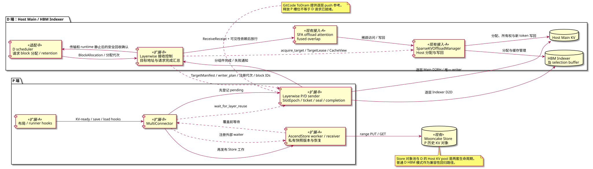
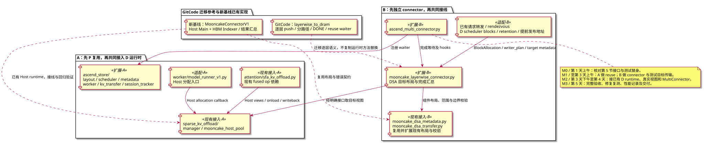
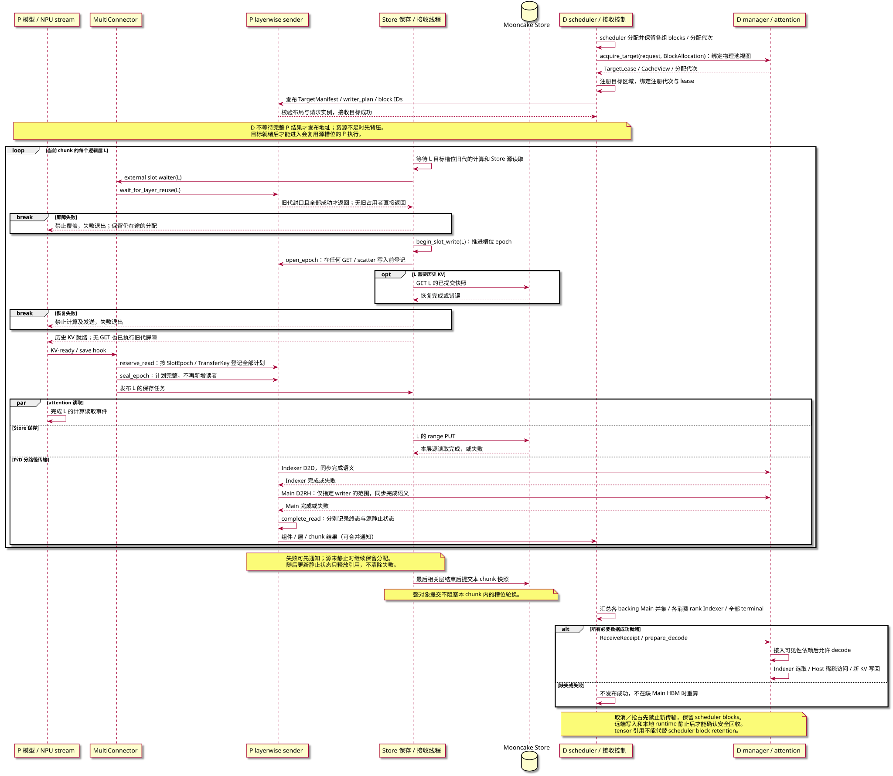
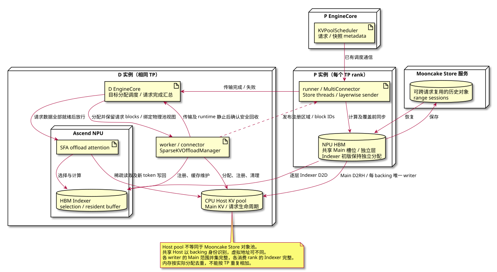
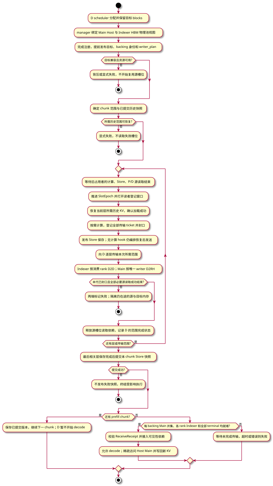

# Mooncake 逐层 P/D 传输与两端 KV Offload 整体设计

## 1. 目标、基线与交付范围

本次交付一条完整的数据路径：Prefill（P）使用少量共享 Main KV buffer，AscendStore 负责历史 KV 保存／恢复，MooncakeLayerwiseConnector 将每层 Main KV 推送到 Decode（D）的 Host、Indexer KV 推送到 D 的 HBM，D 在数据完整就绪后执行稀疏 attention 并将新 KV 写回 Host。P 槽位释放、P 历史快照恢复、D 目标分配和请求就绪属于同一个功能的实现与验收范围。任何下一层写入都不得覆盖尚被计算、Store 或 P/D 读取的 KV。

* 开发基线分支：mazifan0120 的 [dsa_offload_rebase_30](https://github.com/mazifan0120/vllm-ascend/tree/dsa_offload_rebase_30)。
* 固定基线：[4234a1f1815252e8b52c75d6956d0bdf9ae80cc0](https://github.com/mazifan0120/vllm-ascend/commit/4234a1f1815252e8b52c75d6956d0bdf9ae80cc0)。2026-10-31 已联网核对，该提交为所选分支 HEAD；实现与验收固定到此提交，不随浮动分支自动变化。
* 迁移参考：GitCode [b348e1eca3134113c4d890cd2b97abe150a4fe70](https://gitcode.com/shichangzhang064/vllm-ascend/commit/b348e1eca3134113c4d890cd2b97abe150a4fe70)。
* 同时审查后续修复：[1898107769a77dd84e8ae3c6ba524530ca11c55d](https://gitcode.com/shichangzhang064/vllm-ascend/commit/1898107769a77dd84e8ae3c6ba524530ca11c55d)（外部槽位释放接线）和 [b3222a75e040f28de8460ff00897c90ede17e91a](https://gitcode.com/shichangzhang064/vllm-ascend/commit/b3222a75e040f28de8460ff00897c90ede17e91a)（共享层本地 prefix 命中恢复）。迁移语义，不整体 cherry-pick。
* 目标路径：P Main 跨层复用、P Indexer 保持独立分配；D Main 存 Host、Indexer 存 HBM。仅支持已核实的 Main/Indexer 组件布局，不泛化为任意多 group 支持。
* 兼容性要求：关闭 DSA offload 时保留既有普通 D HBM 路径，作为回归基线；完成该路径的测试不等于目标功能已交付。
* 部署限定相同 P/D TP、PP=1，覆盖 chunked prefill、prefix 命中、多请求、取消和失败退出。D 的 Host offload 不等于跨层共享 D 的 Main 分配。
* 范围不包含：D 侧复用、P/D TP 不同、混合 attention/recurrent group、Mamba/KDA、量化传输及 speculative/MTP 特殊布局。开启复用遇到这些组合时须明确拒绝；关闭复用时保留基线行为。
* P/D 使用相同 TP 大小，启动时校验不支持的配置。
* 模型 runner 以基线 V1 路径为验收对象；其他 runner 未验证前不得宣称支持。具体实现以第 6.2 节列出的固定参考实现和实际 checkpoint/cache spec 为适配依据。

新基线已包含 Mooncake Host pool、稀疏 offload runtime、相关 fused operator 和普通 MooncakeConnector 的 blockwise DSA 路径。本次直接复用这些实现，主要开发 P buffer reuse、layerwise P/D 协议和两者接线。代码存在不等于已通过目标模型／硬件验证。

该分支的 release 起点为 [eac9c0cf346edea79b68b9694ece9286dc60ef7e](https://github.com/vllm-project/vllm-ascend/commit/eac9c0cf346edea79b68b9694ece9286dc60ef7e)，不是原先的 [228b10cf95e3daf4a8f9c4595fab2e56f96e5dd6](https://github.com/vllm-project/vllm-ascend/commit/228b10cf95e3daf4a8f9c4595fab2e56f96e5dd6)。两者之间的 release 更新主要涉及构建、依赖与文档；不得假定原基线的 CANN、Triton、memfabric 等版本已包含在新分支中，开发前按新基线核对环境。上游 [releases/v0.30.0](https://github.com/vllm-project/vllm-ascend/tree/releases/v0.30.0) 作为版本来源；本设计不额外要求将新分支合回原基线。

这里的两个 worker 指两位开发者，以下称开发者 A、B。本文件为设计与工作分配，不表示功能已实现或完成 NPU 验证。

## 2. 已有能力和实际缺口

以下路径均相对于目标基线仓库。

| 模块 | 基线已有能力 | 本次工作 |
| --- | --- | --- |
| kv\_pool/ascend\_store/layerwise\_cache\_layout.py | 共享物理布局、独立层、槽位映射及配置解析 | 复用现有规划器，让 Mooncake 按受支持条件加入 |
| kv\_pool/ascend\_store/backend/mooncake\_layerwise.py | block-key range/session 传输 | extract\_layout\_config() 当前返回 None；接入布局并修正复用时加载范围 |
| kv\_pool/ascend\_store/pool\_worker.py | GVA 复用编排、Mooncake layerwise 编排 | 移植 Mooncake 复用编排；解除相关接口对 GVA 的不当限制 |
| kv\_pool/ascend\_store/kv\_transfer.py | range 接收路径已有 save wait 和 external-slot waiter | 确认空任务、失败路径及计算结束屏障都覆盖 |
| kv\_p2p/mooncake\_layerwise\_connector.py | 实际地址到槽位映射、pending/completion、wait\_for\_layer\_reuse() | 审核完成语义和跨 step 生命周期；必要时小范围补齐 |
| ascend\_multi\_connector.py | provider 优先、复合等待回调、shutdown 顺序 | 确保 Mooncake Store 真正接受且执行回调；验证接线失败路径 |

上述路径的公共前缀是 vllm\_ascend/distributed/kv\_transfer/。物理分配基础不是 [b348](https://gitcode.com/shichangzhang064/vllm-ascend/commit/b348e1eca3134113c4d890cd2b97abe150a4fe70) 首次引入；目标已有的新版布局不应被旧版 model runner 合并逻辑覆盖。

以下区分新基线已有能力与外部迁移参考，避免重复计入运行时移植工作：

| 来源 | 已有能力 | 本次迁移／接入 |
| --- | --- | --- |
| GitCode `MooncakeLayerwiseToDramConnector` | D 提前发布 Host/Indexer block IDs，P 逐层 push，两种内存类型分批传输，复用等待接口 | 作为 layerwise 时序主参考；适配目标基线的地址映射、事件和错误契约 |
| 新基线 `MooncakeConnectorV1` DSA 路径 | Main Host / Indexer HBM 布局与注册、组件范围校验、各 rank 结果汇总 | 直接复用现有布局 helper 与注册能力，扩展 layerwise 路径；不直接照搬 one-shot blockwise receive |
| sparse offload manager / Host pool / SFA backend | Host 分配、稀疏访问、selection buffer、新 KV 写回及 fused-overlap 依赖 | 新基线已有；A 接入目标视图／生命周期并验证运行时，B 消费视图；不重复移植 Host runtime 或 kernel |

### 2.1 4+1 视图的阅读约定

以下 SVG 图由 PlantUML 源文件编译生成，描述本次设计完成后的结构，帮助定位新增行为与现有模块的关系，不表示这些修改已经实现。

* `<<现有>>`：复用基线能力，不计划重写该模块。
* `<<扩展-A>>` / `<<扩展-B>>`：在现有模块中接入或补齐行为，由开发者 A/B 负责；不代表新建同名组件。
* `<<现有接入-A/B>>`：新基线已有的实现，由 A/B 分别完成 layerwise 目标视图、注册或生命周期接入；不重复移植模块。
* `<<适配-A/B>>`：对现有分配、调度或请求转发入口进行必要修改；私有快照状态仍优先落在已有 metadata/session tracker 中，不新增独立服务。
* 组件图实线箭头表示调用或数据传递，虚线表示规划、注册或状态依赖；具体含义写在连线上。图中的“等待”是控制依赖，不是 KV 数据流。

| 视图 | 主要回答的问题 | 对应正文 |
| --- | --- | --- |
| 逻辑视图 | P 复用、Store、D Host offload 如何协作？ | 第 3、5、6.2 节 |
| 开发视图 | 修改落在哪些文件，A/B 如何独立开发？ | 第 7 节 |
| 进程视图 | 提前分配、分组件传输、P 源释放和 D 就绪如何同步？ | 第 4、5、6.2 节 |
| 部署视图 | 哪些对象在 CPU/NPU，哪些数据经过网络？ | 第 1、3、8 节 |
| 场景视图（+1） | 一次复用如何串起所有模块，失败在哪终止？ | 第 6、8 节 |

### 2.2 逻辑视图：职责和接口



布局规划器决定逻辑层共享哪些物理分配；runner 消费规划并发出已有 hooks。A 把 Mooncake 路径接入该规划及恢复流程，B 补齐 P/D 的源读取生命周期并完成 MultiConnector 接线。P runner 复用现有规划入口；D runner 复用基线已有的 Host allocation callback，按需补齐 layerwise 视图接线，由 offload manager 统一拥有物理池，scheduler 管理请求 blocks。

图中 Store PUT/GET 为 P 历史 KV 保存和恢复服务；DSA 模式的直接 P→D 传输分为 Indexer D2D 与 Main D2RH。D 的 Host pool 是请求级运行内存，不是 Store 的跨请求对象池。P/D 的完成事件只证明它自己的源读取结束，不能替代 Store 或 attention 的完成事件。快照版本则决定“下一次恢复读取哪个对象”，不能拿它的整对象提交事件阻塞同一 step 的逐层槽位轮换。

### 2.3 开发视图：代码归属与依赖



文件路径以第 2 节公共前缀为准；A 包内文件位于 `kv_pool/ascend_store/`，runner 文件位于 `vllm_ascend/worker/`。图中箭头表示职责依赖，具体字段通过已有 metadata 结构传递，不要求新增直接 Python import。

参考分支文件的路径与版本见第 6.2 节。A 负责 D 的 Host/Indexer 物理池及视图、P Main/Indexer 恢复布局和已有 offload 运行时的接线／验证；B 负责把 ToDram 逐层协议适配到现有 layerwise connector，新增 DSA 接收布局、地址发布和完成汇总。

A 使用模拟 waiter 验证“外部读取未结束就不能覆盖”；B 使用测试构造的共享地址和可控 sender 验证“发送未完成就不能放行”。A 先完成 P buffer reuse、Store 保存／恢复和覆盖屏障；B 同期使用模拟或测试分配的 Host/Indexer 目标完成 connector。两个独立模块通过验收后，再共同接入真实 D offload runtime、MultiConnector 和请求入口。模拟 sink 提前验证接口，真实接线属于共同集成阶段。双方共享的是第 5 节接口契约，而不是互相操作对方的内部事件集合。

### 2.4 进程视图：线程、事件与覆盖顺序

以下时序以相邻占用者共享 Main 槽位为例，展示 D 提前发布目标、逐层分路径传输和请求就绪；省略 TP 通信细节。逻辑参与者表示执行职责，不表示每个参与者都是独立进程；实际计算和拷贝在 NPU stream 上执行，CPU 线程通过对应事件确认完成。



pending 必须在发送入队前登记，并先于 Store 发布可能推进复用的工作。`wait_for_layer_reuse` 使用将要进入的层定位共享槽位，等待旧占用者的所有相关读取完成。DSA 传输按组件维护结果，该 rank 按 writer_plan 分配到的传输路径均成功才形成局部层传输成功；没有 Main 范围时不制造虚假的 Main payload；D 的请求级就绪还需汇总所有必要层、范围和 rank。

没有历史 GET 时，`opt` 中的数据加载省略，但上面的全部屏障仍然执行。GET 本身失败也必须走加载失败路径，不能发出成功的 layer-load 通知。图中的失败返回不表示在途源读取已被取消；仍在读取的 buffer 必须按第 5.2 节保留到安全退出。

### 2.5 部署视图：进程、内存和网络边界



这是逻辑部署边界，P、D 和 Store 可以按现有部署方案放在不同主机或共用主机；本次不新增服务。Store 的存储介质沿用部署配置，图不假设所有 KV 一定驻留主机 DRAM。传输若需要 staging，应单独记录其位置、内存开销和生命周期，不能将其算作已经消失的内存。

跨层 buffer 复用只发生在 P 的本地 HBM；D Main Host 可由 TP rank 共享同一物理 backing，但各逻辑层仍独立存储。普通模式中 D 使用常规 HBM KV；DSA 模式中 D 使用 Host Main、HBM Indexer 和受限 selection/resident buffer，不保留完整 Main HBM 副本。每个 TP rank 保护自己的物理槽位，CPU waiter 不跨机器共享；远端传输结果通过本地 sender 的完成状态反馈。内存验收分别统计 P 共享 KV/独立层、D Host Main/HBM Indexer/selection、staging 及注册区域。多个 rank 映射同一 Host 区域时按物理分配去重，避免重复计算。

### 2.6 场景视图（+1）：用例串联与验收

选取“D 提前准备目标 → P 连续 chunk 逐层复用并推送 → D 完整就绪后进行稀疏 decode”作为贯穿场景。下图的所有节点都是控制流程；对象提交与源槽位释放按第 4 节分别管理。



每个 chunk 的快照处理不代表 P/D 请求完成；D 必须满足每个共享 backing 的 Main 并集覆盖、各消费 rank 的 Indexer 覆盖及全部 terminal 条件才开始 decode。之后每个新 token 的 Main KV 由 offload 运行时写回 Host。旧 Store 快照只能在 GET 引用及后续恢复依赖消失后回收。

| 场景 | 关联模块与新增行为 | 验收重点 |
| --- | --- | --- |
| 首个 chunk，无历史 GET | A 的空加载屏障 + B 的槽位 waiter | 同一 chunk 内旧层仍在发送时，后续共享层不能覆盖 |
| 连续 chunk，包含 partial block | scheduler/metadata + session tracker + range receiver | 读取明确的已提交版本，新 PUT 不覆盖正在 GET 的旧版本 |
| 本地 prefix 命中 | scheduler + Store 恢复计划 | 共享 HBM 不视为有效历史副本；Store 范围不足或 GET 失败时禁止继续 attention |
| Store 快、P/D 慢 | MultiConnector 接线 + sender completion | 只等 Store 完成不够；实际写入必须等待 P/D 源读取结束 |
| DSA Main 或 Indexer 单路径失败 | 分组件结果 + D 请求完成汇总 | 不允许仅凭一个组件或最后层通知进入 decode |
| D 目标未准备好 | D scheduler + rendezvous + P admission | 在 P 首次需覆盖前完成接线；资源不足时背压，无环形等待 |
| 请求取消、发送异常或迟到 callback | P/D 代次状态 + Store 错误闭环 | 错误唤醒不误报成功，旧完成通知不释放新代槽位，在途源内存不被提前回收 |

五个视图描述同一个实现：逻辑视图确定责任，开发视图定位代码，进程视图给出释放条件，部署视图明确内存归属，场景视图将这些条件转为第 8 节的可执行验收项。

## 3. 配置与物理布局

沿用现有配置项，不引入另一个含义重复的 reuse\_buffer 布尔开关：

```json
{
  "use_layerwise": true,
  "layerwise_num_shared_buffers": 3,
  "layerwise_prefetch_layers": 1,
  "layerwise_independent_layers": [0, -1]
}
```

此片段属于 AscendStore 的 extra config，不是完整启动命令；完整 MultiConnector P/D 启动示例由 B 在联调时提供并验证。

* layerwise\_num\_shared\_buffers 决定共享层的物理槽位数；layerwise\_prefetch\_layers 是调度参数，不能当作 HBM 层数。
* 独立层单独分配；示例明确保留首尾层，避免把旧提交默认值强加给目标版本。目标布局目前默认独立层为 [0]，本次保留其默认值。
* 未设置共享 buffer 数时沿用基线默认，不隐式开启物理复用。
* 规划器输出是槽位映射的唯一来源。P/D 根据实际已分配地址确认别名关系，不自行按层号取模推导。
* 复用配置校验包括合法层号、正整数、cache spec/shape/dtype 兼容、角色、runner 与本次支持矩阵。预取窗口必须受实际槽位依赖约束；不能仅凭窗口大小允许覆盖。
* 相同大小的层，在固定 block 容量下，KV 内存近似与“独立层数 + 实际共享槽位数”成正比；还需计入 staging、通信及元数据内存。默认内存预算可能换来更多 blocks，而不是进程 HBM 总量下降。
* 目标路径复用新基线普通 connector 的 `dsa_pd_offload` 语义，但需要在 layerwise connector 中实现并校验，不是给当前基线增加配置就能启用。普通模式默认关闭该选项。
* 目标路径要求 D 的 `sparse_kv_offload_config.enabled=true`、`host_backend="mooncake"`、`use_fused_overlap=true` 和 `kv_load_failure_policy="fail"`；P 的 sparse decode offload 保持关闭，P 的 Store layerwise reuse 单独启用。配置项分别属于原有 connector extra config、additional config 或 transfer config，不合并成一个虚构 JSON。
* P 初版只复用 Main，Indexer 保留独立物理分配，按真实 cache spec/组件身份关联，不假定两个 group 的编号、物理 page 或 stride 相同；首版要求 Main/Indexer 及双端的 manager block size 相同。模型原生跨层 Indexer 别名若无法证明最后读取者及版本关系，启动时拒绝该组合，不能按层号猜测。
* `manager_block_size_tokens` 表示 scheduler／manager 的逻辑 block token 数；`page_size_tokens` 表示 tensor 物理 page token 数。首版各 group 和双端采用相同 manager block size；物理 page、stride、block IDs 可以不同，manager block 必须能被各自 page 整除。不支持不同 manager block size，启动时明确拒绝，不将其列入正向验收。
* 验收前必须固定 checkpoint、Main/Indexer dtype、page stride、token 覆盖和既有 kernel 支持矩阵；不会因接入 DSA 自动启用其他混合模型或缓存量化组合。

## 4. 安全不变量与逐层时序

设旧层 L 和新层 M 共享物理槽位 S。允许向 S 加载或写入 M 之前，必须同时满足：

1. L 对 S 的计算读取已经完成，不能把 KV scatter 完成等同于 attention 完成。
2. Store 已完成对 L 本代源 buffer 的读取；提交异步任务不算完成。此处不等待当前整对象提交，加载 M 所用的历史快照另须已提交。
3. P/D 已完成对 L 源 buffer 的读取；DSA 模式包括 Main 与 Indexer 的所有相关传输及读者。发送入队、RPC 提交成功均不算完成。
4. 之前任何关联失败都已传播，不能把异常后的 event.set() 解释成成功。

概念时序如下。Store 保存和 P/D 发送之间无需串行，三方读取结束之后才能复用。

三方读取完成后，才允许加载历史层 M 并计算／写入共享槽位。完整时序见第 2.4 节。具体流程：

1. on\_kv\_cache\_written / save\_kv\_layer 中，MultiConnector 先让 P/D 登记 pending，再允许 Store 发布可能推动复用的任务。同一代工作经两种 hook 进入时不得重复登记或重复发送。
2. Store 为 M 创建加载任务，携带当前物理层索引和前一槽位占用者的保存依赖。索引使用基线已有执行层／物理层映射，不能混用 group 内索引。
3. 接收侧等待旧层计算／保存完成，再调用外部 P/D waiter；全部成功后才能覆盖。A 必须对照实际 NPU event 的记录位置证明计算读取已结束，而非仅依赖变量名。
4. wait\_for\_layer\_load(M) 只在上述屏障及必要 H2D 均成功后返回，使模型计算也不能绕过屏障。
5. 即使没有远程 GET（新请求首 chunk、零加载范围或本地 prefix 命中），共享槽位仍须经过屏障任务。不能因任务列表为空而跳过等待。
6. 独立层不增加不必要的共享槽位等待，关闭复用路径保持原行为。

必须区分 source\_read\_done 与 snapshot\_committed：前者参与决定同一 step 内层间覆盖；后者允许下一 step 恢复该版本。基线 Mooncake 对象含整组层，最后相关层才提交对象，因此当前 step 的槽位屏障绝不能等待这个提交，否则可能形成“下一层等提交、提交等最后层、最后层等槽位”的循环。新 step 不得把尚未提交的版本作为恢复来源；提交失败即使发生在源槽位释放之后，也必须使该快照失效并终结受影响的执行。

## 5. A/B 接口契约

本节预先定义 A、B 的协作契约。第 1 天前半天由两位开发者核对实际字段映射、事件位置和底层完成保证，随后独立开发，无须需求方参与具体接口设计。新增类型和方法是拟实施接口，不表示目标基线已经提供；已有公共 hook 保持签名，通过内部适配层接入。优先复用现有 metadata、队列和 event。

| 接口 | 提供方／使用方 | 契约 |
| --- | --- | --- |
| set\_external\_slot\_release\_waiter(waiter) -> bool | A 的 Store 接收 B 的 MultiConnector 回调 | 仅在实际安装到所有可覆盖共享槽位的路径后返回 True；线程创建前后注册都有效 |
| wait\_for\_layer\_reuse(layer\_idx) -> None | B 的 P/D 提供给 A | 等待目标层将覆盖的旧代封口且源读取完成；失败抛异常；无旧占用者可返回，已打开但未封口不能返回 |
| LayerLoadTask.wait\_for\_save\_layer | A 的 worker → receiver | 表示前一占用者的保存依赖；不能替代独立的计算完成保证 |
| wait\_for\_layer\_load(layer\_name) | MultiConnector → Store → 模型 | 包含空加载时的覆盖保护，失败时禁止继续计算 |
| sender completion | B 内部 | 所有提交任务都有且仅有一次有效终结；已入队但失败、取消、shutdown 均可结束等待并传递失败 |

接口注册阶段可能尚未分配 KV。能力协商可以提前完成，但实际复用激活后的注册校验必须确认槽位映射和 waiter 均存在。显式启用复用却没有有效接线时应启动失败，不能静默降级为无保护执行。

基线 P/D worker 的 wait\_for\_layer\_load() 是空实现；不能仅凭 MultiConnector 的 provider-first fallback 就宣称有保护。完整路径必须由 Store 成功接收并执行 waiter；B 负责补充明确校验或真正有效的 fallback，二者选一并写测试。

### 5.1 并发与完成语义

B 首先核对 Mooncake 调用返回和 callback 对源 buffer 生命周期的保证。如果传输经过 staging，只有独立 staging 已完成源拷贝且自身不会被提前复用，才可提前释放源槽位；否则等实际传输完成。

基线按层 pending 和槽位 event 的机制需要证明同一槽位同时只有一代工作。若存在同层重复提交、多个发送项或跨 step 延迟 callback，必须用代次标识和 pending 计数（或等价串行约束）处理：旧 callback 不得释放新一代槽位，单个请求完成不得释放仍服务其他请求的槽位。优先复用现有队列约束；只有证明不足时才扩展状态。

不要持有 sender 完成回调需要的锁等待 event；不要把正常完成等待放在全局设备 synchronize 上。

### 5.2 取消与退出协议

B 在第一阶段核实底层同步传输的超时、取消及源读取终止保证。基线 sender 的阻塞队列循环和“线程是否存活”检查本身不能解决线程活着但传输卡住的情况。

退出顺序为：停止接收新任务 → 终结尚未执行的排队任务 → 处理在途源读取 → 唤醒失败等待者 → 回收线程及内存。错误可提前通知等待者，但通知失败不等于源 buffer 已安全释放；失败后禁止新计算覆盖该 buffer。

本次正常 shutdown 采用 drain；传输异常优先使用底层有保证的超时／取消。如果在途读取无法取消，在读取结束前必须保留源分配；需要有界退出时走 worker 进程终止及传输资源销毁路径，不能在仍运行的 worker 内仅设置 event 后复用内存。实际采用的超时来源、进程退出责任方和资源销毁保证须由 B 在第一阶段记录并验证；无法证明则阻塞该场景验收并更新排期。分别测试“等待者有界失败”与“传输及资源安全退出”。

### 5.3 交付范围与责任

| 边界 | 提供方 | 使用方 | 冻结内容 |
| --- | --- | --- | --- |
| P 物理布局与槽位代次 | A | B | 真实分配映射、槽位身份、占用代次与 KV-ready 依赖 |
| P/D 源读取保护 | B | A 的 Store receiver | pending 登记、封口、源读取完成、失败及退出语义 |
| Store 恢复与快照 | A | A 的恢复路径；B 只消费恢复后的视图 | 已提交版本、恢复范围与完成事件；私有 key 不进入传输协议 |
| D 目标内存视图 | A | B | Main Host / Indexer HBM 布局、分配 lease、消费可见性 |
| 目标注册、发布与传输 | B | P/D connector | 注册实例、协议版本、目标代次、范围和完成结果 |
| MultiConnector 接线 | B | A/B 的 provider、sink | pending 在 Store 任务可运行前建立，waiter 确实被安装及执行 |
| D decode 与内存回收 | A 的运行时；B 提供传输结果 | D scheduler | 全请求成功才放行；在途写入和运行时引用全部结束才回收 |

A 的 manager 拥有物理池、视图和运行时引用；D scheduler 拥有请求 block 分配及回收权限；B 拥有传输注册、传输引用和 scheduler 生命周期接线。B 不能自行修改 scheduler 的 block 映射，也不能另分配一套 Main。物理池引用与请求 block 保留是两层保护，A/B 不能仅凭请求取消就释放仍被使用的任一层。

### 5.4 共同数据模型

以下字段是接口语义名称；落到已有类型时允许名称适配，但不能丢失身份、范围或生命周期信息。所有区间为 token 的左闭右开区间 `[start, end)`，字节单位字段以 `_bytes` 结尾。组件使用枚举 `MAIN`、`INDEXER`，不能用 group 编号猜测。

| 类型 | 必需字段 | 约束 |
| --- | --- | --- |
| `RequestKey` | `request_instance: str`、`transfer_generation: int` | instance 是一次请求生命周期的唯一标识，由入口生成并传播到双端及所有 rank；generation 由请求传输协调者分配，各 rank 不得自行推导 |
| `SlotKey` | `worker_instance: str`、`group_id: int`、`slot_id: int` | 标识实际共享分配；跨组件或 group 的物理别名必须归一到同一所有者，或启动拒绝 |
| `SlotEpoch` | `slot: SlotKey`、`epoch: int`、`logical_layer: int` | epoch 在每次槽位换占用者时递增，包括跨 step；不能用层号代替 |
| `TokenRange` | `start: int`、`end: int` | `0 <= start <= end`；空范围可以携带终结语义，不产生数据读取 |
| `CacheView` | `logical_layer`、`component`、`group_id`、`memory_kind`、`dtype`、`shape`、`strides_bytes`、`manager_block_size_tokens`、`page_size_tokens`、`block_capacity`、`region_offset_bytes`、`region_binding` | 本地绑定 `(allocation_id, allocation_generation)`；发布到远端时绑定 `(engine_instance, region_id, registration_generation)`，逐维布局可验证；不假定 Main/Indexer 的 block 数、stride 或编号相同 |
| `LocalRegion` | `allocation_id`、`allocation_generation`、`base_address`、`length_bytes`、`owner_lease` | 仅本地使用；对象／tensor／lease 不直接序列化；地址在 lease 有效期内稳定 |
| `RegisteredRegion` | `engine_instance`、`registration_generation`、`region_id`、`backing_id`、`backing_generation`、`backing_offset_bytes`、`transport_endpoint`、传输后端要求的地址／句柄、`length_bytes`、`memory_kind` | B 从有效 LocalRegion 注册得到；远端只使用已协商的描述；backing 字段由共享池分配者生成并传播，不从虚拟地址推导；重启或重新注册后旧描述失效 |
| `TargetManifest` | `protocol_version`、`request: RequestKey`、`rank`、`expected_ranks`、`regions`、`views`、各组件 `block_ids`、`block_allocation_generation`、`writer_plan`、`required_ranges` | 覆盖整个待传 prompt；required_ranges 按层、组件、目标 backing／消费 rank 及指定 writer 列出；注册成功且分配已保留后才发布 |
| `BlockAllocation` | `request: RequestKey`、`allocation_generation`、`group_block_ids`、`manager_block_size_tokens`、`prompt_tokens`、`retention_token` | D scheduler 从实际分配结果建立；retention_token 是生命周期保留记录的标识，不是 Python 引用；worker 仅消费不可变描述 |
| `LayerTransfer` | `operation_id`、`request`、`rank`、`logical_layer`、源视图及其 `SlotEpoch`、目标描述身份、各组件 token/block 映射、`ready_fence` | operation_id 是请求、rank、层内稳定的父任务 ID；每个组件／范围生成独立 TransferKey；重复 hook 不能创建新任务；ready_fence 是真实 KV 可读事件 |
| `TransferKey` | `request: RequestKey`、`rank`、`logical_layer`、`operation_id`、`component`、`token_range`、`target_scope` | target_scope 绑定 backing/消费 rank 与 block 分配代次；组件子任务的唯一身份；读者登记和结果去重都使用完整键；底层分段属于该子任务，不单独完成 ticket |
| `TransferResult` | `key: TransferKey`、目标注册身份、`status`、`error_code`、`error_message` | status 为 SUCCESS/FAILED/CANCELLED；成功只覆盖已实际完成且目标可见的有效范围 |

`SlotEpoch` 属于物理分配，并不属于单个请求：一个 batch 的多个请求可能共享同一层的槽位，必须共同参与该代的读者计数。`RequestKey.transfer_generation`、`SlotEpoch.epoch` 和 Store 的 `snapshot_generation` 是三种独立版本，不可相互替代。

每个 CacheView 必须通过显式 `region_binding` 唯一解析到所属区域，禁止依赖 regions/views 的列表顺序。B 注册时保留本地 allocation 与注册区域的对应关系；生成远端视图后，按绑定区域校验 offset、stride 和最终访问范围不越界。目标分配代次仍由 TargetLease 和目标描述身份校验，不能仅凭注册区域未变化就复用旧请求的 block 映射。

D 的 `required_ranges` 来自明确的 prompt 长度及模型缓存语义，不从实际收到的消息反推。初版不使用 D 本地 prefix 省传。目标 block 映射在该 manifest 的传输期内不变；需要换映射时，先终止并排空旧传输，再发布新代次。

### 5.5 P 槽位与传输读者接口

A 提供以下内部入口；命名可映射到已有 layout/receiver 类，行为固定：

```python
get_layer_views(layer_idx: int) -> tuple[CacheView, ...]
get_current_epoch(layer_idx: int) -> SlotEpoch | None
begin_slot_write(layer_idx: int) -> SlotEpoch
```

`get_current_epoch(M)` 查询 M 将写入的物理槽位当前占用者，可能是旧层 L。`begin_slot_write(M)` 只允许在旧代的 attention、Store 和外部 P/D 屏障全部成功后调用；它推进 epoch，再允许 GET、scatter 或其他写入。独立分配也要保留正常生命周期，但不添加跨层共享等待。

B 在内部实现以下等价能力；这些不是要求向 vLLM 增加的公共 hook：

```python
open_epoch(epoch: SlotEpoch) -> None
reserve_read(epoch: SlotEpoch, key: TransferKey) -> ReadTicket
seal_epoch(epoch: SlotEpoch) -> None
complete_read(ticket: ReadTicket, outcome: ReadOutcome) -> None
wait_epoch(epoch: SlotEpoch) -> None
```

* A 在新代允许写入时通过已安装的适配器通知 B `open_epoch`。处于 OPEN 的代次不能因为暂时没有 pending 就被视为可复用。
* 在当前代任何任务可被异步消费前，B 为每个实际源读者调用 `reserve_read`。同一 `(SlotEpoch, TransferKey)` 的重复登记返回同一 ticket；不同请求、组件或范围分别计数。一个子任务若读取多个源分配，须为各自的 SlotEpoch 分别登记，所有底层分段停止读取后才能释放对应 ticket。
* 当前层／step 的 batch 计划确定后，协调代码调用 `seal_epoch`，表示该代不会再新增读者。多请求 batch 不能由首个请求提前封口；零传输也必须显式封口。跨 chunk 再次写入走新 epoch。
* `wait_epoch` 只有在 SEALED、所有 ticket 的源读取已安全结束且无失败时返回。未打开的新分配可作为无旧占用者处理；已打开但未封口不能按“无 pending”返回。
* `ReadOutcome` 必须区分 `status` 与 `source_quiesced: bool`。失败可以立即唤醒并抛异常，但 `source_quiesced=false` 时仍保留分配，禁止覆盖。源已静止但请求失败也不能返回成功。
* `complete_read` 分别更新终态结果与源静止状态。相同结果重复通知幂等；`FAILED/CANCELLED + source_quiesced=false` 后允许同一终态更新为 `source_quiesced=true`，仅释放资源引用，不把失败等待改为成功。终态互相冲突或静止状态从 true 回退为 false 属于协议错误；错误不能阻止已证实静止的资源引用安全回收。旧 epoch 的回调仅清理旧代引用，不改变当前代状态。
* 锁仅保护状态变更；等待设备事件、网络传输和条件变量时不持有完成回调所需锁。优先使用现有有序队列证明封口与提交顺序；如果已有机制满足这些语义，不强制新增同名方法。

保持外部兼容接口：`wait_for_layer_reuse(layer_idx) -> None` 由 B 实现。它利用 A 的真实映射解析目标层将覆盖的旧 `SlotEpoch`，再执行 `wait_epoch`。A 必须保证查询到屏障完成之间没有另一写者推进该槽位；初版沿用 worker 的单一有序写入调度，若实际存在并发写者则须增加原子占用检查。

### 5.6 D 目标视图、注册与交接接口

A 提供运行时适配接口，B 使用同一接口的测试替身开展独立开发：

```python
acquire_target(request: RequestKey, allocation: BlockAllocation) -> TargetLease
get_target_views(lease: TargetLease) -> tuple[CacheView, ...]
prepare_decode(lease: TargetLease, receipt: ReceiveReceipt) -> None
release_target(lease: TargetLease) -> None
```

`TargetLease` 同时绑定 LocalRegion 和 scheduler 的 BlockAllocation，持有物理池引用及请求 blocks 的保留记录。B 在 `update_state_after_alloc` 消费实际各 group block IDs 并建立分配代次，先确认 scheduler 保留记录有效，再交给 A 的 `acquire_target`；该接口只绑定已有分配，不能按 prompt 长度另分配请求 blocks。两组件容量必须覆盖完整 prompt，否则背压／失败，不发布半套目标。B 注册内存后生成 TargetManifest；注册失败须清理已注册资源并通知 scheduler 按安全释放条件解除 block 保留。

`ReceiveReceipt` 由 B 按第 6.2.3 节的 writer_plan 收齐各共享 backing 的 Main 范围并集、各消费 rank 的 Indexer 范围及全部 terminal 后生成，绑定 RequestKey、目标代次及目标可见性依赖。A 的 `prepare_decode` 校验这些身份，并将实际传输后端要求的 Host／设备可见性与消费 stream 依赖接入运行时，然后才允许 scheduler 放行。只有控制面消息到达，不能代替数据可见性。

B 在第 1 天记录所用 Mooncake/ADXL API 的返回语义：是否保证源读取结束、远端写入完成、Host 可见，以及是否仍需 fence。尚不能证明的保证不能填成一个默认已完成事件。

释放分为请求 blocks 和物理池两层：`release_target` 仅发起释放请求；B 必须在所有可能访问目标的 P 端停止新提交、在途远端写入静止且 A 的 attention／写回引用归零后，向 scheduler 返回匹配 RequestKey 和 block 分配代次的安全释放确认。只有 scheduler 收到有效确认后才解除 retention 并把 blocks 归还空闲池；之后本地视图／注册引用才能按所有权释放。持有 tensor 引用不能代替 block 保留。

B 通过既有 `request_finished`／`request_finished_all_groups`、worker `get_finished` 结果及 scheduler output 通道接入正常结束与取消；成功接收通知不能被复用为取消后的资源安全确认。`update_state_before_preempt` 只是抢占通知，不假定它已能延迟释放。B 必须核对目标 vLLM 的取消／抢占路径：若既有 hook 不能保留在途目标 blocks，则增加最小 scheduler 生命周期适配，延后回收并维持同一 retention 记录；无法接通则禁止激活该模式，不能仅递增 generation 后立即重分配。A 提供本地 runtime 静止状态，B 负责跨 rank／远端传输静止汇总及回收确认。此项属于 B3 的接线工作。

取消或抢占时先禁止新提交并撤销目标发布，再终结排队任务，等待在途写入及运行时读写结束，最后归还 blocks。旧代回调不得解除新代 retention；新请求即使外部 request ID 相同也必须拥有新实例。无法安全取消 DMA 时继续隔离目标 blocks，按第 5.2 节安全退出。D 缺少完整 Main HBM，不通过普通 recompute 完成抢占回退；终结失败请求并安全归还资源。

### 5.7 传输与完成协议

B 的调度入口承担以下行为：

```python
publish_target(manifest: TargetManifest) -> None
submit_layer(transfer: LayerTransfer) -> TransferHandle
finish_rank(request: RequestKey, rank: int) -> None
abort_request(request: RequestKey, reason: str) -> None
```

1. `publish_target` 完成版本、实例、容量、布局及注册校验后才能使 P 获得目标。P 在目标可用前不进入需要该目标的共享槽位执行；等待目标使用现有请求背压机制。
2. `submit_layer` 先验证整个计划并登记源 ticket，再使任务可运行。等待 KV-ready 后，Indexer D2D、Main D2RH 分批执行；各传输路径独立记录结果。单路径失败使请求失败，其他在途传输路径仍须安全结束。
3. `TransferHandle` 分别提供源静止状态与远端完成结果，不能用一个布尔值表达两者。初版不引入 staging 提前释放，只有确认底层不再读取源后才完成源 ticket。
4. `finish_rank` 表示该 rank 不会再新增所需范围，不补造缺失的成功结果。空 payload 也必须发送 rank terminal；接收方仅在按 writer_plan 的 Main 并集／Indexer 消费 rank 覆盖完整、全 rank terminal 成功且数据可见时生成 ReceiveReceipt。
5. 对重复成功结果按完整 TransferKey 幂等处理，Main 与 Indexer 的结果分别累计；重叠范围须来自一致版本且内容不可被并发改写。初版禁止不同 TransferKey 同时写同一目标字节，partial block 只传有效范围；需要整页写入时先串行化并证明整页有效。
6. `abort_request` 先阻止新提交并发布失败，再排空／终止已提交工作；失败不可被迟到成功覆盖。重试只有在源 epoch 仍有效、目标注册和分配代次未变化时允许，否则失败并结束该传输代次。

传输 wire 格式仅携带可序列化值；本地 event、tensor 和引用对象保留在 worker。B 定义扩展模式的版本常量，双方不支持该版本时在发送前失败；普通模式沿用原协议。错误至少区分布局不兼容、目标失效、范围不足、传输失败、取消和依赖失败，并接入既有 scheduler 错误通道。

### 5.8 Store 恢复与 MultiConnector 的固定时序

A 对 B 暴露的是恢复后的 CacheView、有效 TokenRange 和 ready fence，不是 Store 私有对象 key。Store 内部保存接口必须区分 `source_read_done` 与 `snapshot_committed`；传输逻辑不等待当前 chunk 的整对象提交。

正常计算层按以下顺序编排：

1. A 等待旧占用者全部屏障，推进槽位 epoch，B 打开新代登记窗口。
2. A 恢复历史范围并执行计算；KV-ready 事件标记可发送数据，attention-done 事件单独保护计算读取结束。
3. B 为该 batch 的全部发送计划登记 ticket；Store 保存任务可与发送并行，但任何推动下一次覆盖的任务都必须看到已建立的登记窗口及 pending。
4. 计划完整后封口；下一共享层经 Store receiver 等待旧代的计算、Store 源读和 B waiter，成功后才能写入。

prefix 命中而跳过计算的层仍走：旧代屏障 → 新 epoch → Store 恢复 → 恢复完成事件 → B 登记／发送 → 封口。其 attention 依赖明确为“本层无计算读者”，不能等待不会产生的事件。完全无 GET 的层也执行旧代屏障。

B 负责调用 `set_external_slot_release_waiter` 并检查返回值；A 只有在全部可能覆盖入口都实际接线后返回 True。初始化时可先协商能力，KV 分配后必须核验布局和真实 sink；开启复用却未接线时启动失败。单 connector 测试可以使用模拟 sink；生产组合必须走真实 Store receiver。

### 5.9 A、B 独立开发的测试交付

| 测试替身／契约测试 | 负责人 | 必须证明 |
| --- | --- | --- |
| 可控 P/D waiter | A | 未完成、失败、OPEN 未封口均阻止覆盖；不使用 sleep 猜测时序；空 GET 也会调用 |
| 测试 TargetLease provider | B | 使用实际注册所需的 Host/NPU 内存及真实 stride；接口与 A 相同，生产代码无第二分配器 |
| 多请求同槽位 ticket 测试 | B | 单个请求完成不释放整槽位；同父任务的 Main/Indexer 分别计数；重复 TransferKey 不重复计数；旧回调不释放新代 |
| 恢复与发送契约测试 | A+B | prefix 无计算 hook、跨 chunk、partial tail 都提供正确范围和 ready fence |
| 双路径与 rank 汇总测试 | B | 任一传输路径延迟／失败、缺一 rank、空 terminal 都不会错误放行 D |
| 目标生命周期测试 | A+B | 取消后在途写入仍持有目标；重新注册／请求 ID 重用后旧结果失效；交换 regions/views 顺序不改变显式绑定 |
| 失败后的资源静止测试 | A+B | 先报告失败且源未静止，再报告同一失败且源已静止：等待者保持失败，引用仅释放一次 |

上述测试是现有任务的组成部分，不额外建立一套测试框架。B 的独立阶段须包含真实 NPU/Mooncake 传输；mock 只验证状态机，不能替代硬件完成与可见性验证。

## 6. Store 状态恢复与边界处理

A 迁移的是 [b348](https://gitcode.com/shichangzhang064/vllm-ascend/commit/b348e1eca3134113c4d890cd2b97abe150a4fe70) 的复用语义，保留目标版本公共完整 block key、group 及发布兼容性；请求私有快照允许按下述协议扩展版本身份，不直接照搬旧 session 实现。

* **本地 prefix 命中**：逻辑命中不表示共享 HBM 仍存着该层。共享层需从 Store 恢复完整所需前缀；独立层可以保留 HBM-tail 优化。必须包含 [b3222a75](https://gitcode.com/shichangzhang064/vllm-ascend/commit/b3222a75e040f28de8460ff00897c90ede17e91a) 的回归场景。
* **本地命中而 Store 不足**：scheduler 必须核实整个所需恢复范围。Store 完全 miss、部分命中短于本地前缀、查询失败均不能沿用“无 GET、保留本地命中继续执行”的分支。本次采用显式失败，禁止进入读取未恢复 KV 的 attention；不承诺自动撤销本地命中并重算。A 负责 scheduler→metadata→worker 的错误闭环，覆盖没有 LoadSpec 的入口以及查询后对象被淘汰的情况。
* **chunked prefill**：下一 chunk 恢复上一 chunk 的已提交快照；partial block key/有效 token 范围、request identity、已提交版本与当前未提交版本必须区分。不能仅依赖当前 token 数推导历史快照。
* **最后一个 prefill chunk**：释放会话和删除恢复依据不是同一件事；P 侧后续仍可能执行计算时，需要保留相应快照。结束策略按实际请求生命周期验证。
* **Store miss/失败**：复用层恢复失败后不得读取旧槽位内容继续计算；本次记录 invalid-block 信息并显式失败，禁止未经验证地沿用自动 recompute 路径。
* **请求取消与 ID 重用**：释放 lease/session 和 pending 状态；已提交异步传输必须先安全终结，不能提前重新分配其源内存；旧 callback 不得影响新请求。
* **异常和退出**：失败可唤醒等待者，但必须先留下可见错误；线程退出不得制造成功完成。保留 provider 优先 shutdown，避免 Store receiver 等待已不可运行的 sender。
* **TP**：所有 rank 的本地 buffer 均需等待其计算和传输结束；非 Store 保存 rank 也不能跳过设备 event 同步。

### 6.1 私有 partial snapshot 协议

基线单 group 路径使用固定 {req\_id}\_lastblock，旧 [b348](https://gitcode.com/shichangzhang064/vllm-ascend/commit/b348e1eca3134113c4d890cd2b97abe150a4fe70) 使用带 token 长度的 key。两者均不能独自证明请求 ID 重用和跨 step 读写隔离。本次内部恢复采用显式版本身份：

* 逻辑身份为 (request\_instance, snapshot\_generation, group, rank)，关联有效 token 区间、partial block 索引和已保存范围。request\_instance 在请求生命周期开始时生成并传给相关 worker；不能只使用可重用的外部 request ID。
* 每个新快照使用单调递增代次，状态为 pending、committed、failed。PUT 写新 key，GET 只绑定已提交旧 key；不能由当前 token 数反推应加载的旧版本。
* 最后相关层提交成功后才发布 committed 版本；失败保留错误及仍可用的旧版本，禁止将失败版本当成命中。多 rank 不得各自选择不同的有效进度继续执行。
* 旧版本须在 GET lease/引用释放，且没有未来 chunk 恢复依赖后才回收。revoke 失败或所有权不确定时保留待清理记录，不能假装回收成功。
* 公共完整 block key 不变；初次外部 prefix 导入仍按现有公共协议读取。内部私有 key 不作为未协商的 P/D wire 字段；若初始导入依赖外部 partial key，保留单独解析分支，不能把外部 request ID 当成本地私有实例。
* A 负责把身份、状态和有效区间放入已有 metadata/session tracker；身份字段遵循第 5.4 节，实际类型映射和私有 key 编码在第 1 天接口补丁中确定。B 将 Store 私有快照版本与传输代次分开；DSA 通过明确的协议版本扩展握手，普通模式保持原 wire contract。

### 6.2 两端内存布局与逐层传输协议

#### 6.2.1 参考实现及迁移边界

本次以 mazifan 固定提交作为实际开发基线，GitCode 提供逐层传输迁移参考：

| 基线／参考 | 固定版本及关键代码 | 采用的设计 |
| --- | --- | --- |
| GitCode [mte_fuised_rebase_0713_mooncake_test-0817-both-pd](https://gitcode.com/shichangzhang064/vllm-ascend/tree/mte_fuised_rebase_0713_mooncake_test-0817-both-pd) | [0d6dd0d26ab69219f861c9b312329f4c60fe36f2](https://gitcode.com/shichangzhang064/vllm-ascend/commit/0d6dd0d26ab69219f861c9b312329f4c60fe36f2)；`mooncake_layerwise_to_dram_connector.py` | `MooncakeToDramDecodeScheduler` 提前分配并发布目标；`MooncakeToDramProducerWorker` 逐层 push；Indexer D2D 和 Main D2RH 分批；DONE 与 payload 解耦；`wait_for_layer_reuse` 接入 Store |
| 开发基线：mazifan [dsa_offload_rebase_30](https://github.com/mazifan0120/vllm-ascend/tree/dsa_offload_rebase_30) | [4234a1f1815252e8b52c75d6956d0bdf9ae80cc0](https://github.com/mazifan0120/vllm-ascend/commit/4234a1f1815252e8b52c75d6956d0bdf9ae80cc0)；核心 connector 移植提交 [89819603923fbac05f5a697e3884d69435876d0c](https://github.com/mazifan0120/vllm-ascend/commit/89819603923fbac05f5a697e3884d69435876d0c) | `DsaCacheLayout`、Host Main / HBM Indexer 注册、token 范围校验和 DSA 各 rank 结果汇总；结合 manager、Host pool 及 attention 路径 |

逐层传输时序以 GitCode ToDram 为主参考；新基线已有 DSA 布局、注册、错误处理及运行时可直接复用。基线 `_MooncakeDsaDecodeScheduler` 是 one-shot blockwise receive，可能在 P 完成后才读取源，不能直接用于会跨层覆盖的 P buffer。

不整体引入旧 ToDram 类，也不复制其运行时替换 sender 方法的方式。目标实现是在现有 `MooncakeLayerwiseConnector` 内按模式选择组件布局与传输策略，普通模式保留既有行为；把可复用的范围计算／校验放入 helper。新基线和参考分支中不同 TP、特殊拓扑及其他非当前范围代码不在本次 layerwise 模式中自动启用。

固定基线已选择 legacy Host 注册路径：Host Main 与 HBM Indexer 都需注册。此前 VMM/indexer-only 注册的辅助函数仍可能存在，但不作为本次实现依据。A/B 根据实际 backing storage、容量与注册位置校验，不从 tensor 名称或仅从设备标签推断驻留介质。

#### 6.2.2 内存与请求目标协议

A 的 offload manager 管理 D Main Host 和设备侧物理池／视图，D scheduler 分配各请求的逻辑 blocks；B 从 scheduler 分配结果绑定视图、注册并传输，不能再次分配另一套 Main 或用旧分支 CPUBlockManager 覆盖现有分配语义。D 新 token 需要更多 blocks 时仍由 scheduler 分配，manager 提供相应视图，不能由 connector 自行扩展 block 映射。

D scheduler 在 P 开始可复用的逐层执行之前，分配并保留整个待传输 prompt 范围的目标 blocks；worker 绑定 TargetLease 并注册成功后发布目标描述；复用已有 layerwise rendezvous/metaserver 机制，必要时适配请求转发入口。D 分配失败则背压或失败，不允许 P 等最后请求级 metadata、D 又等 P 完成的循环。

目标描述采用第 5.4 节的共同数据模型，通过有版本的协议携带以下字段；到基线类型的字段映射在第一天核对：

| 字段组 | 内容及校验 |
| --- | --- |
| 身份 | engine/注册实例、request instance、传输代次、TP rank；与可重用的外部 request ID 分开 |
| 组件布局 | 逻辑层与 component（Main/Indexer）、group ID、注册区、dtype、统一 manager block size、组件 page size、stride、block capacity、共享 backing 身份 |
| 目标范围 | Main Host block IDs、Indexer HBM block IDs、有效 token 区间；分别转换，不假定两种 block IDs 一一同号 |
| 目标寿命 | scheduler block 分配代次／retention、物理池及注册代次；取消、重连、重用 block 后旧描述不能继续写入 |
| 完成结果 | 请求实例、代次、rank、层／组件及有效范围的成功或失败；允许批量编码，语义上不能缺失 |

B 先校验两组件布局、边界和容量再提交任何传输；同一 ADXL 传输批次不混合 NPU→NPU 与 NPU→Host。目标容量不足或缺少组件时失败，不先传一半再把请求当作成功。

#### 6.2.3 逐层传输、源释放与 D 就绪

共享 Host 的 TP 写入计划在目标发布前确定，不能依靠各 rank 的虚拟地址是否相等识别共享：

* 每个共享区域使用 `(backing_id, backing_generation)` 标识物理 backing，区域偏移使用 `backing_offset_bytes`。同一 backing 在不同进程的注册地址可以不同；目标重叠校验按 backing 字节区间执行。
* 对每层 Main，D 为同一 backing 建立有序 `writer_ranks`。沿用参考实现，以请求内目标 manager block 的序号 `destination_ordinal` 选取唯一 writer：`writer_ranks[destination_ordinal % len(writer_ranks)]`，不是对物理 block ID 取模。按相同 TP 的明确 rank 映射指定 P sender 与 D 注册端点，writer_plan 携带每个 writer 的预期 token 范围。
* 该分工只适用于候选 P sender 都持有相应完整 Main 内容的受支持复制布局。启动／握手核验模型 Main 布局和 rank 映射；若是未支持的 Main 分片布局或无法证明 writer 可提供其范围，明确拒绝，不能用轮询分工猜测。不同 backing 各自需要完整覆盖，不能合并不同 backing 的结果来宣称完成。
* Indexer 按每个 D 消费 rank 的独立 HBM 目标传输，初版采用受支持的同 TP rank 映射；不套用 Main 的 writer 过滤。Main 无分配范围的 rank 仍可能发送 Indexer，且必须发送 terminal。
* Main 仅累计指定 writer 成功完成的范围；非 owner 的结果不能补覆盖，错误 writer 在提交前拒绝。D 就绪条件是每个 backing 的 Main 范围并集完整、每个消费 rank 的 Indexer 完整及所有 terminal 成功；不要求每个 rank 单独拥有完整 Main 接收记录。每个消费 rank 还必须接入共享 Host 的可见性依赖。

沿用 ToDram 的 push 方向：P 在层数据可读后发送到 D 提前发布的地址。逻辑层 L 内先执行 Indexer D2D、再执行 Main D2RH；其他顺序只有在保持相同完成契约时才可优化。发送依赖具体 KV-ready 设备事件，而不是仅依赖 CPU hook 被调用。

每次任务的身份至少区分 `(request_instance, transfer_generation, layer, component, token_range)`。P 入队前登记共享源槽位 pending；成功返回必须确认该代所有相关源读取结束。初版不依赖额外 staging 提前释放，也不把“发送已入队”作为完成。发生异常时唤醒等待者并记录失败，但在途源和目标仍须保留至传输安全终止。

定义两种独立完成条件：

* **P 源可释放**：该槽位当前代所有必要传输已停止读取，且未出现关联失败；再与计算／Store 源读取屏障共同决定下一层是否可覆盖。已有 `wait_for_layer_reuse()` 继续作为外部接口。
* **D 请求可执行**：每层、每个共享 backing 的指定 Main writer 范围并集覆盖完整 prompt，各消费 rank 的 Indexer 所需范围完整，全部预期 rank 的 terminal 成功，数据对对应 NPU 消费 stream 可见，且 terminal 状态未失败／取消。此后才由 D scheduler 发布接收成功并允许 decode。

不能把“最后层发送过一次”或“收到一个 rank 的 DONE”直接当作 D 就绪。可保留 ToDram 的最后层批量 DONE 优化，但必须证明前序范围已完成；空 payload 的最后层仍需 terminal 消息。重复成功消息幂等，冲突结果报错，旧代次通知不改变新请求状态；最终失败不能被迟到成功覆盖。

A 的 Store receiver 只等待 P 源可释放，不等待 D 开始 decode；D 也不等待 P 当前 chunk 的整对象 Store 提交才能接受逐层数据。两条路径分别推进，避免引入新的环形依赖。

#### 6.2.4 chunk、prefix 与 decode 执行

P 的 Store 恢复范围与本次 P→D 传输范围分开管理。P prefix cache 命中不代表 D 已有相同 KV；初版 DSA 不启用跨请求 D 本地 prefix 命中省传，D 要求完整 prompt。被 P 跳过计算的历史 KV 必须先从 Store 恢复，再逐层送往 D，不能仅发送新计算 token。

若命中导致某层没有实际计算 hook，A/B 必须显式编排该层的 restore→send 任务，仍走相同槽位 pending 和完成屏障；该任务的 KV-ready 来自恢复完成事件，不能等待不会发生的 attention 事件。不能仅因为没有新 token 或没有普通 save hook 就省略 D 所需的历史数据传输。

连续 chunk 以显式 token 区间累计 D 完成状态。Main 与 Indexer 使用相同 manager block size，但分别按自身物理 page／stride 拆分地址，partial tail 按有效长度传输；禁止遗漏此前 chunk，也禁止对未初始化 padding 建立成功覆盖。若布局要求整页传输，须证明页内容已完整有效，否则等待该页可读或显式拒绝，不能扩大读取范围碰运气。

D 请求完成后，复用已有 sparse offload 运行时：Indexer 选择需要的 KV，fused-overlap 路径从 Host Main 取数并使用设备 selection buffer，新 token KV 写回 Host。该能力不是 connector 内的新 attention 实现。下一步 decode 必须等待所需写回／索引更新的设备依赖，Host buffer 不能在计算或写回仍使用时被回收。

#### 6.2.5 失败、回归与实现门槛

* 任一组件／rank 失败，D 不发布成功；D 没有完整 Main HBM，使用 `kv_load_failure_policy="fail"`，不进入普通 HBM 重算回退。
* 取消后停止新任务，排队任务安全终结；在途写入结束前隔离目标 blocks。网络重试必须验证目标实例及注册代次，禁止对已被覆盖的 P 源重新发起读取。
* D 就绪判断不能只照搬新版 scheduler 的“收齐 rank 即 finished”；必须结合实际 result.kind、invalid-block 传播及整请求范围检查证明错误不会触发 decode。
* A 核对基线已有 manager、Host allocation、fused operator 的运行条件与 layerwise 接口；B 审计提前目标发布和传输完成语义。独立开发里程碑分别是 A 的 P buffer reuse/Store 恢复正确，以及 B 的 connector 在测试目标上的逐层传输与完成接口正确。两者通过后共同接入 D Host runtime 和 MultiConnector，再验证完整 decode；不要求 A 先交付 D runtime 才允许 B 开发。
* 所有代码迁移以目标版本接口为准，参考分支的提交说明和旧测试通过记录不替代本次 NPU 验收。若 Host runtime 或 fused kernel 无法在目标环境运行，应先解决依赖并更新工期，不在 connector 中建立不完整替代路径。

## 7. 两位开发者的统一任务分配

### 7.1 开发者 A：两端内存与 Store 恢复

A 先独立完成 P buffer reuse 与 Store 保存／恢复（A1–A3）；进入共同集成阶段后，再负责基线已有 D Host allocation 和 attention runtime 的接口接入与验证（A4），并与 B 一起验收（A5）。第一阶段核对已有 D runtime 的运行条件和视图接口；不再安排 Host runtime／fused kernel 的整套移植。

| 工作包 | 内容 | 交付标准 |
| --- | --- | --- |
| A1：共同约定接口 | 核对迁移范围，定义槽位、快照与 Host/Indexer 视图契约；核对已有 D runtime 的运行条件 | B 可按约定构造测试目标，无需等待真实 D runtime |
| A2：P 布局与同步 | 接入 Main 共享布局和独立 Indexer；保留空 GET 屏障；正确等待计算、Store 和外部源读取完成 | 假 P/D waiter 未释放时不能覆盖，包括不执行 attention 的恢复任务 |
| A3：历史状态恢复 | 处理 scheduler 本地命中／Store miss、Main/Indexer 有效范围、chunk/partial snapshot、提交与回收 | P 命中历史 KV 也能完整供给 D，未恢复或未提交版本不得被使用 |
| A4：共同集成中的 D 运行时接入 | 复用已有 Host pool／attention／fused operator，接入绑定 scheduler blocks 的视图与生命周期；验证 selection 和新 KV 写回 | 不重复分配 Main；D 无完整 Main HBM 副本，连续 decode 的内容与依赖正确 |
| A5：集成与内存验证 | 与 B 接通真实运行时，验证恢复、写回、取消回收和 P/D 内存统计 | 固定容量的内存数据可复核，失败不导致失效内存被继续使用 |

主责文件：

* `kv_pool/ascend_store/` 下的 `layerwise_cache_layout.py`、`backend/mooncake_layerwise.py`、`pool_scheduler.py`、`metadata.py`、`pool_worker.py`、`kv_transfer.py`、`backend/session_tracker.py` 和必要的 `ascend_store_connector.py` 转发。
* `sparse_kv_offload/sparse_kv_offload_manager.py`、`sparse_kv_offload/mooncake_host_pool.py`。
* `vllm_ascend/worker/model_runner_v1.py`、`vllm_ascend/worker/worker.py` 的必要规划／Host allocation 接入，以及 `vllm_ascend/attention/sfa_kv_offload.py` 的必要接线与回归。现有 kernel 直接复用；只有发现目标路径的具体缺口才修改对应依赖。
* 对应 Store、分配器与 offload runtime 单测；A 提供模拟 P/D waiter，不依赖 B 全部完成后才开发。

除完整 `vllm_ascend/` 路径外，以上文件以前述 `vllm_ascend/distributed/kv_transfer/` 为前缀。

### 7.2 开发者 B：逐层传输、接收控制与 MultiConnector

B 对“P 源读取正确终结、D 收齐数据才执行”的传输生命周期负责。采用先独立开发 connector、再接入 MultiConnector 的顺序；独立阶段已经覆盖 Host Main / HBM Indexer 目标，不另起一条后续适配任务。

| 工作包 | 内容 | 依赖与交付标准 |
| --- | --- | --- |
| B0：协议约定 | 与 A 固定层／组件身份、目标地址视图、传输代次、P 源释放和 D 请求就绪条件；确认超时／取消契约 | 第一阶段完成，不等待真实 Store 实现 |
| B1：独立 connector | 参考 ToDram 提前发布目标、逐层 push；适配组件布局／注册、双路径传输、源槽位 pending、错误和 terminal 汇总 | 用模拟 Host/Indexer 目标和受控 sender 验证；旧 callback 不释放新槽位，单路径成功不触发 D decode |
| B2：独立传输验证 | 使用测试分配的 Host Main / HBM Indexer 和受控共享源槽位验证双端内容、地址注册、分路径传输和终结 | 不依赖 A 的真实 D runtime；此阶段不以完整模型 decode 为完成标准 |
| B3：共同集成中的实际接线 | 对接 A 的真实 Host/Indexer 视图，注册 Store waiter，接通 MultiConnector、请求转发／rendezvous 和 scheduler block 保留／安全回收通道；验证初始化与退出 | A2/A3 和 B1/B2 独立验收通过后开展；与 A4 并行完成真实运行时接入 |
| B4：完整验收 | 覆盖 prefix、chunk、慢传输、多请求、多 rank、取消／错误；完成性能记录、启动配置和使用文档 | 第 8 节全部通过，普通 HBM 模式回归通过，不能仅以“发送成功”结项 |

主责文件：

* `kv_p2p/mooncake_layerwise_connector.py`、`ascend_multi_connector.py`。
* `kv_p2p/mooncake_dsa_metadata.py`、`kv_p2p/mooncake_dsa_transfer.py` 的必要 helper，以及传输注册接口。
* 现有请求转发／rendezvous 入口和 D 接收结果汇总；实际修改路径在 B0 确认并记录，避免遗漏启动接线。
* `tests/ut/kv_offload/test_mooncake_layerwise_connector.py`、`test_ascend_multi_connector.py` 及相应协议／布局测试、双端测试脚本与文档。

B 不另行实现生产 Host 分配器或 attention kernel；A 不修改 B 的 sender 内部事件。独立阶段的共享源槽位和接收 buffer 由测试代码构造；共同集成阶段才切换到 A 的真实分配器提供的视图。普通 `MooncakeConnectorV1` 仅提供可复用参考，不与 layerwise sender 同时承担同一请求的传输。

### 7.3 共同接口、依赖和交付顺序

* 开发前用半天共同冻结第 5、6 节契约和实际 checkpoint/cache spec。A/B 从固定 SHA 建隔离分支；跨边界文件修改交给该文件主责者，避免合入互相覆盖。
* A 使用假 P/D waiter；B 使用假 Store sink 与模拟 Host/Indexer 视图。两者独立开发不改变真实接口的完成语义。
* 先并行完成 A2/A3 与 B1/B2，并各自提供可复现测试。两侧均通过后再开始共同集成：A 做 A4，B 做 B3；目标视图可用后，先验证真实 Host 接收／decode，再验证 MultiConnector 下的 P 共享槽位全链路。
* B 审核 A 的覆盖点，A 审核 B 的释放点；共同确认 D 端不存在提前 decode 或在途目标回收。
* A 是最终集成负责人，B 是双端验收负责人；每个阻塞项记录责任人和依赖。
* 提交按模块边界组织：A 的布局／Store／运行时，B 的协议／connector，MultiConnector 接线与共同验收。所有提交共同服务一条完整功能路径，不按“基础功能”和“附加 offload”拆分交付承诺。
* 实际提交遵循仓库签署与检查规范；本文不授权自动推送、合并或部署。

### 7.4 独立开发转入共同集成的门槛

| 独立交付 | 必须通过的检查 | 此时不要求 |
| --- | --- | --- |
| A：buffer reuse + Store | 真实物理地址共享；prefix/chunk/partial snapshot 正确恢复；空 GET 仍执行屏障；模拟外部读取未完成时不覆盖；失败可终结 | D 的真实 offload runtime、真实 P/D 网络发送 |
| B：layerwise connector | 测试目标的 Main/Indexer 内容正确；发送前 pending、源读取完成后释放；延迟／重复／失败通知正确；空 payload terminal 不丢；协议接口测试通过 | A 的真实 Store、真实模型 decode、完整 MultiConnector 联调 |

B 的双端测试在可用 NPU/Mooncake 环境运行，目标 buffer 由测试工具分配，不建立第二套生产 Host allocator。只有 mock 测试而没有真实传输验证时，必须明确标记该项未通过，不能把“connector 已完成”当作生产验收。共同集成仍需重新验证两端真实布局、设备事件及接口调用位置，独立测试不能替代完整链路测试。

## 8. 测试矩阵与验收

| 场景 | 必须证明的结果 | 责任人 |
| --- | --- | --- |
| 关闭复用／共享数足够大 | 原布局和传输行为保持，既有 UT 通过 | A+B |
| 共享槽位、独立层、非法配置 | 别名正确，独立层不别名；不支持组合显式失败 | A |
| Store 慢／attention 未结束 | 不覆盖旧层，设备事件完成后才继续 | A |
| P/D 慢，Store 已完成 | Store H2D 和模型下一次写入均不能越过 P/D 屏障 | B+A |
| 首 chunk／空 GET／本地 prefix 命中 | 没有实际 GET 也保护槽位，共享层 prefix 正确恢复 | A |
| 本地 prefix 非零、Store 为零或更短、查询后淘汰 | 不因没有 LoadSpec 跳过恢复校验；未恢复时显式失败且不执行 attention | A |
| 单共享槽位、最后层尚未执行 | 前层源读取结束可推进，不等待本 step 整对象提交；下个 step 不读未提交版本 | A |
| 多 chunk、partial block、最后 chunk | 快照版本和有效 token 正确，无旧数据混入 | A |
| 三个连续 partial chunk、中途 PUT 失败、相同 ID 重建 | 版本隔离、失败不发布、旧请求快照不串入新请求 | A |
| 多请求共用一次层发送／重复 hook | 不早释放、不漏释放、不重复发送 | B |
| 跨 step 延迟 callback、取消后新请求 | 旧完成通知不释放新一代槽位 | B |
| enqueue/传输/Store 失败、sender 停止 | 有界退出或可观测失败，无死锁和静默损坏 | A+B |
| 相同 TP>1，非保存 rank | 所有 rank 正确等待本地计算和通信 | A+B |
| MultiConnector 配置顺序／晚注册 waiter | 实际接线有效，provider 先登记，无法接线时报错 | B |
| shutdown 有在途任务／同步传输卡住 | 分别验证等待者失败与传输安全终止；不提前回收源内存 | B+A |
| DSA 提前目标发布与资源不足 | D 目标先就绪再进入可复用 P 执行；不足时背压，无请求级握手死锁 | B |
| manager block size 相同，Main/Indexer 物理 page／stride 不同及 partial tail | 按各自 page 正确生成地址与范围，无越界和未初始化 padding 读取 | B+A |
| 不同 manager block size 或不能整除的 page | 启动／握手明确拒绝，不作为支持组合运行 | A+B |
| TP 共享 backing、不同虚拟地址、writer 无 Main 范围 | 唯一 owner 写入；Main 并集完整、Indexer 各消费 rank 完整；空范围 rank 的 terminal 不丢 | B+A |
| Indexer 成功而 Main 失败，及反向故障 | D 不运行 decode；源与目标在途访问安全终结 | B |
| 最后层空 payload、重复 DONE、迟到旧代 DONE、缺一个 rank | 不丢 terminal，也不错误提前报告整请求成功 | B |
| P prefix 命中但 D 无缓存，多 chunk 输入 | D 收到完整所需 prompt，已命中历史范围不漏传 | A+B |
| DSA decode 多 token、selection 命中／miss、新 KV 写回 | Host 内容、Indexer 与输出持续正确；无完整 Main HBM 隐式分配 | A |
| 取消／抢占时立即申请新请求，或重启注册实例 | scheduler 在远端写入及本地运行时静止前不归还旧 blocks；旧回调不解除新代 retention | B+A |
| 普通 D HBM 模式回归 | 关闭 DSA 后使用原布局与协议，输出及生命周期正确 | B |

单元测试使用可控 event/barrier 与模拟完成 callback，不依赖 sleep 碰概率。以每层不同的 sentinel KV 内容检测覆盖污染；同时断言阻塞发生的位置及错误传播。

NPU 端到端由 B 编排、A 协助，至少覆盖：复用关闭基线、共享 buffer 数为 1/2/3、独立首尾层、不同 prompt 长度、跨多个 chunk、prefix 命中、多请求，以及人为降低 P/D 速度。任何配置若被实现明确限制，必须把限制及原因写入启动校验和文档，而不是跳过测试后声称支持。

端到端 NPU 验收固定目标模型和 kernel 版本，与同 checkpoint 的普通 HBM decode 对比：长 prompt、多个 chunk、本地 prefix 命中、Main/Indexer 单路径延迟、同 TP 多 rank 和连续生成。分别报告 D Host、Indexer、selection、staging 以及 P 共享槽位内存，确认没有完整 D Main HBM 副本。

验收输出：

1. 每层 KV 对比（适用时）和确定性生成结果，或预先记录的合理数值容差。
2. 固定模型、block 容量、token 数下的 KV 分配字节与峰值 HBM，另报 staging 内存；不能仅比较自动扩容后的进程总 HBM。
3. 相同负载下的 TTFT、吞吐、P/D 传输耗时及各屏障等待时间；目标是无不必要全局同步，收益不预先保证。
4. 所有新增与相关既有 UT 的结果、失败注入结果、双端环境/版本/启动参数。缺 NPU 环境时标记未验收，不能以 mock 测试替代。
5. 按仓库要求运行 bash format.sh ci；新功能提供 UT/ST，涉及性能路径提供基准。保留无复用场景的既有多 group 等回归，虽然其复用模式不在本次范围。

## 9. 工作量、执行顺序与交付门槛

### 9.1 目标与估算前提

计划由两位开发者并行完成，目标为 **5 个工作日** 完成功能验收与交付，总投入约 **10 人日**。所有时间以半天为最小安排单位；接口核对、独立测试、运行时适配、联合验收和一般问题修复均包含在内，不另加一份公共联调预算。此估算以新基线已有 D Host/runtime/helper 为前提，不再包含从原 release 基线移植整套 DSA 运行时的工作；节省的时间用于 layerwise 适配、scheduler retention 和联调，保持五天目标。第 1 天上午核对接口，至第 3 天上午完成独立验证，第 3 天下午至第 4 天共同集成，第 5 天完成第 8 节验收、一般问题修复及复测、性能记录、启动配置和交付文档；无额外第 6 天预算。若独立验证或完整验收未通过，记录阻塞并更新日期，不将未完成项计为已交付。

| 负责人 | 独立阶段 | 共同集成与验收 | 总投入 |
| --- | --- | --- | --- |
| A | 核对接口，完成 P buffer reuse、Store 保存／恢复及屏障测试 | 已有 D runtime 的视图／生命周期接入、写回验证，内存和正确性验收 | 5 人日 |
| B | 核对接口，完成 layerwise connector、测试目标传输及完成／失败测试 | 真实视图、MultiConnector、请求流程接线，端到端与性能验证 | 5 人日 |
| 合计 | A/B 并行，均须达到独立阶段退出门槛 | 完整交付同一条 P→D 路径 | 10 人日 |

### 9.2 第一天接口交付

第 1 天前半天由 A、B 共同提交一份可评审的接口补丁或等价类型／适配器骨架，并填写以下核对结果，无须需求方参与日常接口决策：

* A 标明每个字段映射到的实际类／分配所有者、槽位推进位置、attention 与 restore 事件位置，以及目标运行时依赖。
* B 标明实际传输 API、源静止／远端可见性的证据、超时与取消行为、协议编码、Main writer／Indexer 消费 rank 汇总位置及 scheduler retention／安全回收通道。
* 双方提供最小成功时序及单路径失败时序的契约测试入口，并确认无 GET、无计算 hook 的调用者。
* 冻结数据模型、错误语义和生命周期；内部 helper 名称可以调整。影响边界的变更必须同步修改契约测试及对方适配器，不能仅单边修改实现。

## 10. 证据与审查记录

* [开发基线：4234a1f1815252e8b52c75d6956d0bdf9ae80cc0](https://github.com/mazifan0120/vllm-ascend/commit/4234a1f1815252e8b52c75d6956d0bdf9ae80cc0)，分支 [dsa_offload_rebase_30](https://github.com/mazifan0120/vllm-ascend/tree/dsa_offload_rebase_30)。
* [GitCode ToDram 固定参考](https://gitcode.com/shichangzhang064/vllm-ascend/commit/0d6dd0d26ab69219f861c9b312329f4c60fe36f2)：本地 `/tmp/gitcode-mooncake-both-pd-review`，以已获取版本为依据，不声称是当前远端最新 HEAD。
* [开发基线本地快照](https://github.com/mazifan0120/vllm-ascend/tree/4234a1f1815252e8b52c75d6956d0bdf9ae80cc0)：本地 `/tmp/mazifan-dsa-offload-rebase30-review`。
* 参考核对点：ToDram scheduler 的提前地址发布、producer 的双路径同步写入、`ensure_last_layer_done_signals` 与 `wait_for_layer_reuse`；新版 DSA 的 `_build_dsa_local_layouts`、`_dsa_consumer_register_regions`、`_execute_dsa_receive` 与 scheduler 结果汇总。
* 本文及五张视图是拟实施设计；本轮未修改 connector 生产代码，也未执行 NPU 验收。
